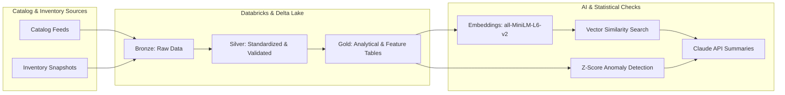

# RetailPulse AI

Retail catalog and inventory intelligence workflow built on **Databricks** and **Delta Lake**, combining semantic product matching, statistical anomaly detection, and **Claude API** summaries over validated outputs.

## Architecture



## How It Works

* **Catalog & Inventory Sources:** Ingests incoming product catalog feeds and inventory snapshots.
* **Databricks & Delta Lake (`Bronze` → `Silver` → `Gold`):** Preserves raw records in Bronze, standardizes and validates schemas/fields in Silver, and prepares analytical and feature tables in Gold.
* **Semantic Matching & Vector Search:** Generates text embeddings with `all-MiniLM-L6-v2` and runs vector similarity search to surface candidate product matches across catalog variations.
* **Z-Score Anomaly Detection:** Flags unusual numeric observations (such as inventory spikes or drops) relative to baseline distributions.
* **Claude API Summaries:** Generates readable triage summaries from structured/validated outputs rather than inventing metrics directly.

## Repository Structure

```text
retailpulse-ai/
├── README.md
├── docs/
├── src/
└── samples/
```
