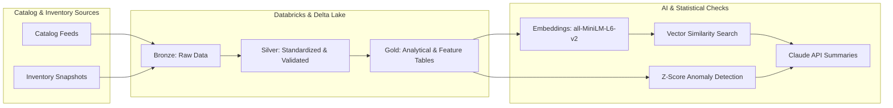

retailpulse-ai/
├── README.md                  # Problem, system boundary, 2 focused diagrams, how to run
├── docs/
│   ├── architecture.md        # Detailed design: medallion flow, 0.92 similarity + SKU checks, Z-score caveats, Claude boundary
│   └── data-model.md          # Logical/analytical tables, grain, keys, and separation of product vs. embedding/insight entities
├── src/
│   ├── ingestion/             # Catalog feeds & inventory snapshot readers/validators
│   ├── medallion/             # Bronze -> Silver -> Gold transformations (PySpark / SQL)
│   ├── intelligence/          # Embeddings (all-MiniLM-L6-v2), similarity, Z-score anomaly logic
│   └── reporting/             # Claude API summary formatter over validated outputs
└── samples/                   # Small synthetic/anonymized sample fixtures (no proprietary/PII data)
